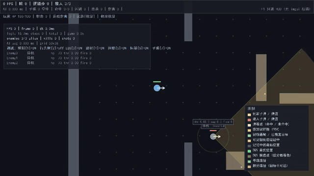
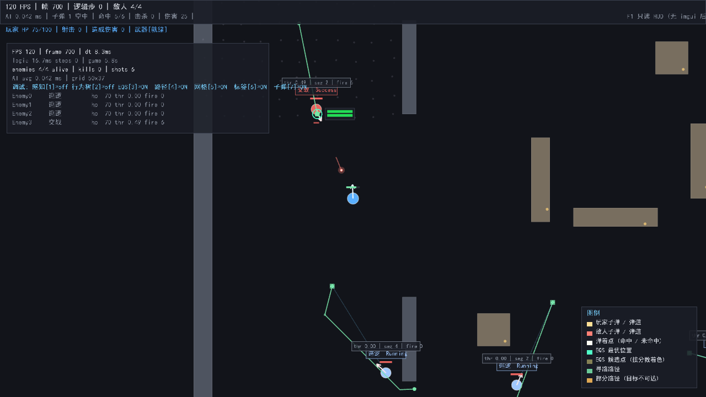
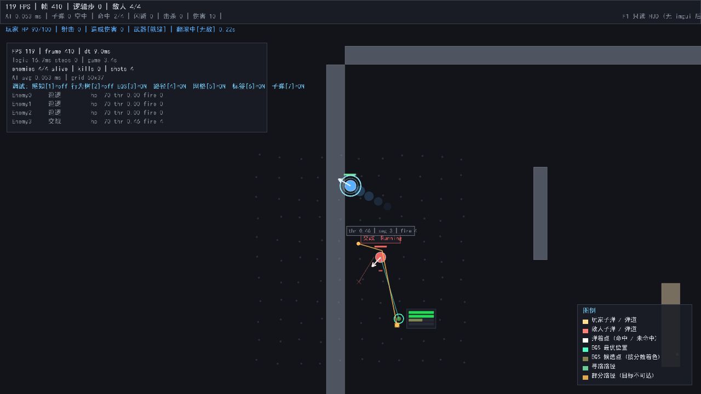

# Tactical AI Sandbox

一个用于实验 **战术 AI** 的 C++17 可交互沙盒。把行为树、黑板、感知、EQS、A\* 寻路串成一条完整的决策流水线，并且**把 AI 的「想法」全部画出来**。

用 Raylib 做窗口与渲染，ImGui 做运行时调参面板，CMake 构建，GoogleTest 做单元测试。



`C++17` · `raylib` + `imgui` · `281 个单元测试` · `60Hz 固定步长` · `无头可回归`

 

**从这里开始：**

| 你想… | 去哪 |
|---|---|
| 跑起来 / 录一段演示 | 下方「[快速开始](#快速开始)」 · [录制 GIF/视频](docs/RECORDING_GIF.md) |
| 理解架构与设计取舍 | [docs/PROJECT_WALKTHROUGH.md](docs/PROJECT_WALKTHROUGH.md)（含演示脚本与预设问答） |
| 看关键代码怎么写的 | [docs/CODE_WALKTHROUGH.md](docs/CODE_WALKTHROUGH.md)（10 个机制逐段解释） |
| 知道踩过哪些坑 | [docs/PLAYABLE_FIXES_2026-10-09.md](docs/PLAYABLE_FIXES_2026-10-09.md) · [docs/TESTING_LESSONS.md](docs/TESTING_LESSONS.md) |

> 上面那段动图是 `--demo`（内置驾驶员）录的，不是手打的：一条命令就能复现。
> 录制方法见 [docs/RECORDING_GIF.md](docs/RECORDING_GIF.md)。

```
┌─────────────────────────────────────────────────────────────┐
│  感知 Perception    →  我看到什么？                           │
│        ↓ 写入黑板                                             │
│  EQS 环境查询       →  哪个位置最好？                          │
│        ↓ 选出目标点                                           │
│  A* 寻路            →  怎么走过去？                           │
│        ↓ 路径点                                               │
│  行为树 Behaviortree →  现在该做什么？                        │
│        ↓ 移动意图                                             │
│  移动与碰撞          →  实际动起来                            │
└─────────────────────────────────────────────────────────────┘
```

---

## 快速开始

```bash
# 1. 获取依赖（raylib / imgui / glm / nlohmann-json / googletest）
pwsh ./scripts/fetch_dependencies.ps1

# 2. 配置与构建
cmake -S . -B build -G Ninja -DCMAKE_BUILD_TYPE=Release
cmake --build build

# 3. 运行
./build/bin/TacticalAI-Sandbox

# 4. 跑测试
./build/bin/TacticalAI-Tests
```

> 不需要 `fetch_dependencies.ps1` 也能构建：CMake 会依次尝试
> `external/` → 系统包 → `FetchContent` 自动拉取。只要三者之一可用即可。

---

## 项目结构

```
TacticalAI-Sandbox/
├── CMakeLists.txt              根构建脚本（选项、编译旗标、子目录）
├── cmake/
│   └── Dependencies.cmake      第三方依赖解析（四级回退策略）
├── src/
│   ├── main.cpp                入口：参数解析 + 各层组装 + 主循环
│   │
│   ├── engine/                 引擎层 —— 与游戏内容无关的基础设施
│   │   ├── Time.h/.cpp         固定时间步、时间缩放、帧率统计
│   │   ├── Input.h/.cpp        输入系统，动作映射 + 消费式边沿触发
│   │   ├── Renderer.h/.cpp     Raylib 渲染封装、2D 相机、RAII 渲染纹理
│   │   └── GameLoop.h/.cpp     固定步长循环驱动器、IGameLayer 接口
│   │
│   ├── ai/                     AI 层 —— 纯逻辑，不依赖窗口
│   │   ├── Blackboard.h/.cpp   类型擦除的共享状态存储，带写入者追踪
│   │   ├── BehaviorTree.h/.cpp 行为树：Sequence / Selector / Parallel / 装饰器
│   │   ├── BehaviorTree.inl    bt::seq / bt::sel 变参模板建造器
│   │   ├── Perception.h/.cpp   视野锥 + 视线遮挡 + 反应延迟 + 记忆
│   │   ├── EQS.h/.cpp          环境查询：生成器 → 打分 → 权重汇总 → 择优
│   │   └── Pathfinding.h/.cpp  A* + 二叉堆 + 视线拉直平滑
│   │
│   ├── game/                   游戏层 —— 实体与世界
│   │   ├── Entity.h/.cpp       实体基类（ID 引用、标签、属性）+ 障碍物
│   │   ├── Player.h/.cpp       玩家：加速度移动、瞄准、开火
│   │   ├── Enemy.h/.cpp        敌方 AI：把五个 AI 模块串成流水线
│   │   └── World.h/.cpp        实体容器、导航网格、感知收集、伤害结算
│   │
│   └── debug/                  调试层 —— 让 AI 变得可见
│       ├── AIDebugDraw.h/.cpp  视野锥、EQS 候选点、路径、状态标签的绘制
│       └── DebugUI.h/.cpp      ImGui 调参面板（无后端时降级为原生 HUD）
│
├── tests/                      GoogleTest 单元测试
│   ├── test_time.cpp           时间系统：确定性、暂停、单步、超步保护
│   ├── test_blackboard.cpp     黑板：类型安全、版本追踪、排序稳定性
│   ├── test_behavior_tree.cpp  行为树：短路语义、Running 跨步、中断清理
│   ├── test_eqs.cpp            EQS：曲线数学、权重归一化、过滤器、确定性
│   ├── test_cover_effectiveness.cpp 掩护度：掩体是否在交火路径上（区别于距离代理）
│   ├── test_enemy_search.cpp   敌人搜索：到位→观察→放弃→恢复巡逻
│   ├── test_walkable.cpp       可站立判定：膨胀检查、越界、生成点不嵌墙
│   ├── test_match_outcome.cpp  对局结果：胜利/失败判定与重开
│   └── test_pathfinding.cpp    寻路：避障、降级、平滑、不穿墙角
│
├── external/                   第三方库源码（由脚本或 CMake 填充）
└── scripts/
    └── fetch_dependencies.ps1  一键克隆依赖
```

---

## 分层与依赖方向

CMake 把每一层编译成独立静态库，**依赖方向被构建系统强制约束**：

```
tacticalai_debug  ──→  tacticalai_game  ──→  tacticalai_ai  ──→  tacticalai_engine
      │                      │                    │                    │
      └──────────────────────┴────────────────────┴────────────────────┘
                        最终可执行文件 TacticalAI-Sandbox
```

| 库 | 职责 | 可否反向依赖 |
|---|---|---|
| `tacticalai_engine` | 时间、输入、渲染、循环 | 不可依赖 ai / game / debug |
| `tacticalai_ai` | 行为树、黑板、感知、EQS、寻路 | 不依赖 game / debug |
| `tacticalai_game` | 实体、世界、战斗结算 | 不依赖 debug |
| `tacticalai_debug` | 可视化与调参面板 | 无（位于最上层） |

这样分层的好处：`tacticalai_ai` 不依赖任何窗口代码，因此**单元测试可以无头运行**，CI 上不需要显示设备。

---

## 运行时操作

| 按键 | 功能 |
|---|---|
| `WASD` / 方向键 | 移动 |
| `Shift` | 冲刺 |
| `空格` | 翻滚（Dodge Roll） |
| `Ctrl` / 鼠标右键 | 瞄准（降低移速） |
| `F` | 开火 |
| 鼠标 | 瞄准方向 |
| 中键拖拽 / 滚轮 | 平移 / 缩放相机 |
| `P` | 暂停逻辑 |
| `.` | 暂停时单步（逐帧看 AI 决策） |
| `Tab` | 慢动作 0.25x 切换 |
| `N` | 生成敌人 |
| `R` | 强制所有敌人重新寻路 |
| `回车` | 重开一局（分出胜负后使用） |
| `1` | 感知视野锥 |
| `2` | 行为树状态 |
| `3` | EQS 候选点 |
| `4` | 寻路路径 |
| `5` | 网格阻挡格 |
| `6` | 实体标签 |
| `F1` | 调参面板显示/隐藏 |
| `F2` | 冻结 AI 决策（玩家仍可动） |
| `F3` | 打印完整世界状态到控制台 |
| `F11` | 全屏 |
| `Esc` / 关窗 | 退出 |

### 调试可视化速读

| 视觉元素 | 含义 |
|---|---|
| 黄色扇形 | 该敌人的视野范围（FOV） |
| 绿色连线 | 视线通畅，目标已锁定 |
| 黄色连线 | 目标可见，但仍在反应延迟中 |
| 灰色连线 + 方框 | 记忆中的最后位置（AI 正在朝这里搜索） |
| 绿色高亮圈 | EQS 选出的最优位置 |
| 按分数着色的点 | EQS 评估过的候选位置（红=差，绿=好） |
| 最优位置旁的小色条 | 各测试项的单项得分（看权重如何起作用） |
| 青绿色折线 | 该敌人的寻路路径 |
| 橙色折线 | 部分路径（目标不可达，只能尽量接近） |
| 屏幕中上方横幅 | 对局结算（胜利 / 失败），失败时提示按回车重开 |

### 对局结果与重开

打完一局会有明确结果，按 `回车` 重开。

| 结果 | 判定 |
|---|---|
| 胜利 | 场上曾有敌人，且现在一个都不剩 |
| 失败 | 玩家阵亡 |

两条容易踩的边界，都由 `tests/test_match_outcome.cpp` 钉住：

- **`--enemies 0` 不算胜利。**「从未生成过敌人」与「打赢了」是两件事，
  否则开局第一帧就显示胜利。
- **失败优先于胜利。** 最后一击可能同时打死玩家和最后一个敌人，
  此时显示失败——「我方团灭」比「敌人清空」更需要被立刻告知。

**失败后世界不会停摆。** 这点曾是个真问题：玩家一死，
感知列表里就没有它了，敌人集体退回巡逻，世界上再也不会有子弹，
统计数字从此不再变化——看起来像崩溃，实则是静默失效。
现在失败只是冻结玩家输入（尸体旁的画面仍可观察），按回车即可重开。

沙盒里允许**胜利后按 `N` 增兵继续打**：胜利是一个可以随时看一眼的状态，
而不是一堵关上的门。真正要重开时按回车。

---

## 命令行参数

```
--width <int>          窗口宽度（默认 1280）
--height <int>         窗口高度（默认 720）
--enemies <int>        初始敌人数量（默认 3）
--fixed-delta <ms>     逻辑步长毫秒（默认 16.667 = 60Hz）
--frames <int>         运行指定帧数后退出
--headless             不创建窗口，只跑逻辑（CI 冒烟测试）
--shot <file>          在第 N 帧把画面存成 PNG
--shot-frame <int>     指定截图帧号（默认取最后一帧）
--capture <目录>       连续导出渲染帧为 PNG 序列（录制 GIF/视频用）
--capture-every <int>  每 N 帧导出一张（默认 4）
--demo                 自动演示模式：内置驾驶员操作玩家，并打开 AI 可视化
--no-eqs               禁用 EQS 选位（对比行为差异）
--no-vsync             关闭垂直同步
--dump                 退出时打印世界状态快照
--help                 显示帮助
```

**无头模式**适合 CI 与行为回归：

```bash
./build/bin/TacticalAI-Sandbox --headless --enemies 8 --frames 3000
```

**截图**用于验证"到底画出来没有"——单元测试断言不了像素：

```bash
./build/bin/TacticalAI-Sandbox --enemies 4 --frames 900 --shot-frame 700 --shot shot.png
```

**录制演示**（不需要人操作；README 首屏那段动图就是这么来的）：

```bash
# 1) 录：内置驾驶员自己走位/瞄准/开火/翻滚，并打开感知 · EQS 候选 · 路径可视化
./build/bin/TacticalAI-Sandbox --demo --capture build/capture \
    --capture-every 6 --width 1024 --height 576 --frames 820

# 2) 合成（结束时会把这行带建议帧率打印出来）
powershell -File ./scripts/make_gif.ps1 -Frames build/capture -Fps 12
```

> 想自己录一段：见 [docs/RECORDING_GIF.md](docs/RECORDING_GIF.md)。
> `--demo` 是确定性的（不含随机数），同一条命令能复现同一段演示。

> 注意：这里没有用 raylib 的 `TakeScreenshot`，它在本工程的窗口配置下有两个坑。
> 一是按 `GetWindowScaleDPI()` 放大读取尺寸，在显示缩放 150% 的 Windows 上会去读窗口
> 之外的区域，产出一张带大片黑边的图；二是它用 `CORE.Storage.basePath + GetFileName()`，
> 会静默丢掉参数里的目录。更要命的是 raylib 的 2D 绘制是批处理的，屏幕空间内容
> （状态栏、HUD）要等 `EndDrawing()` 才提交，抓帧前必须先 flush，
> 否则截出来只有世界层、看不到 HUD。细节见 `src/main.cpp` 的 `captureScreenshot()`。

---

## 设计要点

### 为什么用固定时间步

行为树、EQS 评分、寻路都依赖「每一步的时间间隔完全相等」。若直接用渲染帧的 `deltaTime` 驱动，60fps 与 144fps 下敌人的**决策频率会不同**，调试时无法复现问题。

`GameLoop` 采用经典的固定步长结构：

```cpp
input.update();
time.beginFrame();
while (time.consumeFixedStep()) {     // 固定步长逻辑，确定性
    layer.onFixedUpdate(time.fixedDelta());
}
layer.onVariableUpdate(time.frame()); // 帧率相关：相机、UI 悬停
layer.onRender(time.interpolationAlpha());  // 用 alpha 插值显示
```

同时有**超步保护**（`Time::kMaxStepsPerFrame = 8`）：防止断点调试后累积时间过多，导致「卡顿 → 补步 → 更卡顿」的死亡螺旋。

### 为什么感知系统不直接读敌人坐标

AI 若直接读精确坐标，玩家会立刻感觉「这敌人开挂」。感知系统因此引入三层真实感：

1. **视野锥** — 背后看不见（贴身半径除外，模拟听觉）
2. **视线遮挡** — 墙后看不见
3. **反应延迟 + 记忆** — 看见后要过 `reactionTime` 才确认；失去视线后仍向最后已知位置搜索 `memoryDuration` 秒

在面板里把「反应延迟」从 250ms 调到 0，立刻能感受到 AI 从「像个人」变成「像机器」。

### 为什么用 EQS 而不是硬编码 if-else

「去掩体」是意图，「哪个掩体最好」是另一个问题。EQS 把它形式化为：

```
生成候选点 → 逐项打分 → 加权汇总 → 取最优
```

好处是每个考量因素（距离、掩护度、威胁规避）都是**独立可插拔**的，权重可调。行为调参从「改代码重编译」变成「拖滑块看效果」——这是本项目调试面板存在的全部理由。

### 掩护度为什么不能只量「离掩体多近」

`FindCover` 里掩护度占权重 0.20。它曾经只算「候选点到最近掩体中心的距离」——
测的是"我离某个掩体多近"，而不是"这个掩体对这场交火有没有用"。
掩体落在AI 的**侧后方**时两者距离相同、得分相同，
但那个掩体一点用都没有——AI 会为一个挡不到子弹的掩体专门跑过去。

现在量的是「掩体到**我→目标连线**的距离」，即掩体是否处在交火路径上。

这里有个反直觉的坑值得记下来：**不能用「掩体必须与射线相交」这个更严格的判据。**
因为同时还要一条「候选点必须能通视目标」的硬约束
（否则 AI 躲进掩体后就再也开不了枪——`AimAndFire` 里有 LoS 检查，一枪都不开），
而一旦要求通视，「我→目标」连线上按定义就没有阻挡格，
于是"掩体与该连线相交"**恒为假**。实测 121 个候选点的掩护度得分全部为 0。

一句话：**「我能打到它」与「有东西挡在我们之间」在物理上互斥。**
真实战术靠"探身射击"统一两者，代码里的对应分解是：

| 负责 | 保证 |
|---|---|
| `coverEffectiveness` 测试项 | 掩体离交火路径近（有潜在掩护） |
| `candidateFilter` 硬约束 | 候选点自身通视目标（现在就能还手） |

合起来就是「贴着掩体、探头能打」的位置。
判据实现见 `EQS::coverEffectivenessTest`，测试见 `tests/test_cover_effectiveness.cpp`。

### 黑板为什么要记录「谁写的」

黑板条目带 `lastWriter` 与 `writeCount`。调试面板里若看到某个键的写入次数在几千次以上，那就是性能问题的信号；看到值是 `BehaviorTree` 写的而期望是 `Perception` 写的，就能立刻定位到数据流被谁覆盖了。

### 翻滚（Dodge Roll）的几个参数为什么要这么取

翻滚是沙盒里唯一一个能让玩家**主动改写 AI 命中判定**的手段。在此之前，玩家面对已经在飞的子弹只有"躲到掩体后"和"跑开"两种选择，都无法应对"人在空旷处、子弹已在空中"的情况。

参数都在 `PlayerConfig`（`src/game/Player.h`）：

| 参数 | 值 | 说明 |
|---|---|---|
| `rollDistance` | 150 | 总位移（世界单位 = 像素） |
| `rollDuration` | 0.35s | 总时长 |
| `rollCooldown` | 0.80s | 两次翻滚的**起手**间隔 |
| `rollInvulnTime` | 0.25s | 起手后的无敌时长 |

几个不那么显然的取舍：

- **冷却从"起手"计时，不是从"结束"计时。** 也就是两次翻滚的起手间隔 ≥ 0.8s。于是翻滚结束（0.35s）之后还要再等 0.45s。选这个读法是因为动作游戏里"冷却"通常指"你按这个键的频率上限"，玩家心里数的是按键间隔。
- **无敌只覆盖前 0.25s（约 71%），不是整个翻滚。** 全程序无敌会让翻滚退化成一段无代价的位移，"一有动静就滚"成为最优解，AI 的射击压力形同虚设。留出最后 0.1s 的破绽，才会出现"滚早了照样吃子弹"的时机判断。HUD 上这两段是分开显示的（`翻滚中[无敌]` / `翻滚中[破绽]`）。
- **被拒绝的翻滚请求不排队。** 与开火一致：失败就是失败。若存起来等冷却结束再执行，玩家在冷却里连按几下就会"欠"出一串翻滚，完全无法预测自己在哪一刻会滚。
- **位移曲线沿解析原函数积分，因此"总位移 = 150"是一条代数恒等式**，不管固定步长被调成多少都成立。用"瞬时速度 × 步长"则需要采样点选得恰好（比如取步中点）才精确，换个写法就悄悄偏掉。
- **翻滚期间必须绕开 `clampVelocity`。** 起手速度约 857 单位/秒（三角形速度曲线，收尾归零），而裁剪上限是冲刺速度的两倍 = 560。照常裁剪会削掉一部分位移，而且只在按住 Shift 时最明显——属于极难排查的那类偏差。

---

## 构建说明

### 依赖解析四层回退

`cmake/Dependencies.cmake` 对每个依赖按顺序尝试：

1. 用户指定路径 — `-DTACTICALAI_RAYLIB_DIR=D:/libs/raylib`
2. 项目内 `external/<dep>` — 由 `fetch_dependencies.ps1` 填充
3. 系统包 — `find_package(...)`
4. `FetchContent` 远程拉取 — 可用 `-DTACTICALAI_USE_FETCHCONTENT=OFF` 关闭

构建结束时会打印**依赖解析结果表**，明确每个依赖实际用了哪个来源，方便排查「链接到了哪个版本」。

### 常用 CMake 选项

| 选项 | 默认 | 说明 |
|---|---|---|
| `TACTICALAI_BUILD_TESTS` | `ON` | 构建 GoogleTest 单元测试 |
| `TACTICALAI_USE_FETCHCONTENT` | `ON` | 允许网络自动拉取依赖 |
| `TACTICALAI_WARNINGS_AS_ERRORS` | `OFF` | 警告视为错误（CI 建议开启） |
| `TACTICALAI_ENABLE_ASAN` | `OFF` | AddressSanitizer（GCC/Clang） |

### 无 ImGui 后端时的行为

若 `external/imgui/backends/imgui_impl_raylib.cpp` 不存在（该后端并非所有 imgui 版本都自带），CMake 会探测并自动降级：调试 UI 改用 raylib 原生绘制的**只读 HUD**。项目仍可完整构建运行，只是失去了滑块调参能力。构建日志会明确提示这一点。

---

## 中文显示（乱码排查）

项目有**两条独立的输出通道**，各自需要单独处理编码，踩过的坑记录在这里以便日后排查。

### 1. 控制台输出

**现象**：终端里中文显示为 `M-fM-^WM-...` 之类的乱码。
**原因**：程序输出的是合法 UTF-8，但 Windows 控制台默认按本地代码页（中文系统为 GBK / CP936）解码。
**修复**：`main.cpp` 的 `setupConsoleEncoding()` 在**任何 printf 之前**调用 `SetConsoleOutputCP(CP_UTF8)`。

需要注意两点：
- `setlocale(LC_ALL, "")` 会跟随系统区域（中文系统 = GBK），反而覆盖掉 UTF-8，因此显式用 `setlocale(LC_ALL, ".UTF-8")`。
- 不要 `#include <windows.h>`：它会引入 `Rectangle` / `CloseWindow` / `ShowCursor` / `PlaySound` 等与 raylib 同名的符号，导致大量重定义错误。代码里只 `extern "C"` 声明了实际用到的两个函数。

### 2. 窗口内文字

**现象**：画面里的中文全是空白方块。
**原因**：`Renderer` 此前从未调用过 `LoadFontEx`，一直用 raylib 默认字体——**默认字体只含 ASCII**，任何中文都画不出来。
**修复**：新增 `engine/CjkFont.{h,cpp}`，启动时加载含 CJK 字形的字体。

其中有一个**极难排查的陷阱**：

> raylib 的 `LoadFontEx` **无法解析 `.ttc`（TrueType Collection）**。
> 传入 `.ttc` 时它**不报错**，而是静默返回默认字体（`baseSize` 会变成 10 而不是请求的字号），
> 于是中文照样是方块，且从现象完全看不出哪里错了。

因此 `candidateFontPaths()` 做了两件事：
- 用 `stable_sort` 把**所有 `.ttf`/`.otf` 排到所有 `.ttc` 之前**（这是代码保证的硬约束，不依赖手写顺序）；
- 加载时**逐个候选真正试加载并校验 `baseSize == 请求字号`**，而不是只判断「文件存在」。

本机实测结果：

| 字体 | 格式 | 结果 |
|---|---|---|
| simhei.ttf（黑体） | TTF | ✅ 可用，270 字形 |
| Deng.ttf（等线） | TTF | ✅ 可用 |
| msyh.ttc（微软雅黑） | TTC | ❌ 加载失败 |
| simsun.ttc（宋体） | TTC | ❌ 加载失败 |

若你的机器上所有候选都失败，可用环境变量指定字体：

```bash
TACTICALAI_FONT=/path/to/your-font.ttf ./build/bin/TacticalAI-Sandbox.exe
```

---

## 环境要求

- **CMake** ≥ 3.20
- **C++17 编译器**：GCC ≥ 9 / Clang ≥ 10 / MSVC ≥ 2019
- **Git**（用于获取依赖）
- 可选：**Ninja**（比 Make 快很多）

已在以下环境验证：

- Windows + MinGW-w64 GCC 15.1 + Ninja + CMake 4.0

---

## 已知取舍与后续方向

**刻意未做的**：
- **未使用 ECS** — 沙盒规模在几十到几百实体，虚函数 + 组合完全够用；ECS 会让「按名字查实体、按类型遍历」这类调试需求变得笨拙。
- **未做多线程寻路** — 当前实体数量下单线程足够。`Pathfinder` 本身无共享状态，需要时可每个线程一个实例。
- **未做群体避让** — 实测 6 个敌人、玩家存活期间两两最小间距 60.6（半径和才 22），**重叠 0.0%**。运行时互相穿模只在玩家死亡后出现（敌人失去目标后涌向尸体），不是战斗期问题。
- **掩护度仍是距离近似，不是探身射击** — `coverEffectivenessTest` 量的是掩体到交火连线的距离，能区分"掩体在交火路径上"与"掩体在侧后方"，但没有实现真正的 peek（身体在掩体后、枪口探出）。当前的分解是「掩体离交火线近」+「候选点通视目标」，已经自洽可用。
- **命中判定是简化模型** — 双方都用实体子弹子步进 CCD，但不做翻倒、跳弹、部位伤害。

**可以继续扩展的方向**：
- 战术点（Tactical Point）系统：把掩体、火力点、观察位标注在关卡里，让 EQS 从中选择
- 队伍协同：黑板升级为「队伍共享板」+「个体板」两层，实现包抄与火力掩护
- 行为树可视化编辑器：现有 `BehaviorTree::describe()` 已经能输出结构，接一个图编辑器即可
- 场景序列化：`nlohmann-json` 已链接，`World` 的实体列表可以直接落盘
